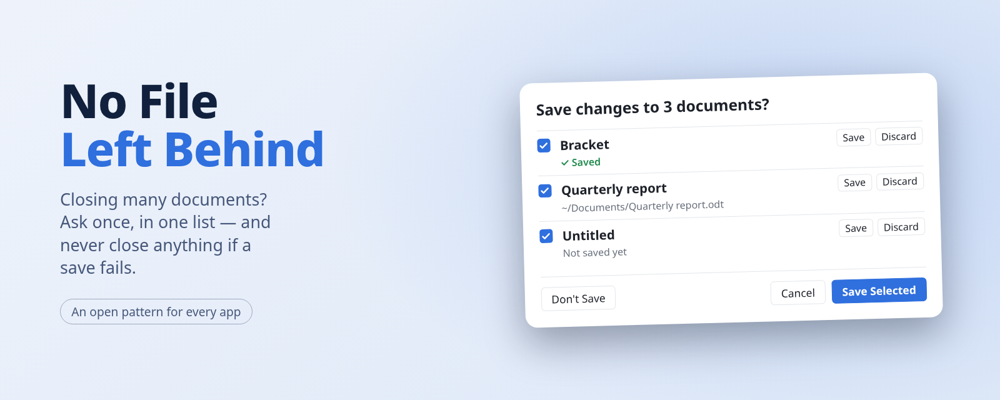

<picture>
  <source media="(prefers-color-scheme: dark)" srcset="images/hero-dark.png">
  
</picture>

# No File Left Behind

**When you close several documents at once, ask about them once, in one list, and never close
anything if a save fails.**

You quit an app with eight unsaved documents. Most apps ask you eight times, one prompt after
another, each in a different spot, and each offering the same three buttons. Somewhere around
the fifth one you stop reading and click Don't Save. That's how work gets lost.

No File Left Behind is an open pattern for that moment. One window lists every unsaved
document. Each row says what it is and where it lives, and has its own **Save** and
**Discard**. The window's **Save Selected** saves everything you leave ticked, and if any save
fails, **nothing closes**.

[**Try the demo**](https://no-file-left-behind.github.io/demo/) · [**Read the specification**](SPEC.md) · [**Implement it**](IMPLEMENT.md) · [**Review checklist**](CHECKLIST.md)

## The pattern in five rules

1. **One list, not N prompts.** Closing two or more unsaved documents at once shows one window
   with a row each. One unsaved document keeps the familiar single prompt.
2. **Every row starts ticked.** The safe default is to keep work, and the window says plainly
   that an unticked document closes without saving.
3. **Each row answers for itself.** A row's own Save or Discard handles just that document, so
   you can deal with the one you're unsure about and leave the rest.
4. **No file left behind.** If any save fails, or you cancel a "Save as" picker, nothing closes:
   not the ones that saved, not the ones you unticked. You fix that one and try again.
5. **Same keys as before.** Enter saves the selection and Escape cancels, as the
   single-document prompt does.

The [specification](SPEC.md) states these precisely, with the edge cases: read-only files, slow
saves, duplicate names, shutdown, screen readers, and scripting.

## Why a standard

Lists like this already exist in a few places, each with its own rules. Some ask for every
file's location up front, some close the documents that did save when another fails, and some
have no way to answer one document at a time. Writing the behaviour down gives app makers one
thing to copy and users the same safe answer everywhere.

## Adopt it

- **App makers:** [implement it](IMPLEMENT.md), by hand or by handing your AI coding assistant
  one link. It is a set of rules, not a library: build it your way, test it against the
  [scenarios](scenarios/), check it against the [checklist](CHECKLIST.md), and say you conform.
- **In a hurry?** There are ready-made [implementations](implementations/) for the web, Qt and
  egui. Using them is optional: an app conforms by meeting the rules, however it is built.
- **Toolkit and design-system makers:** a shared "save several" dialog in a toolkit brings the
  pattern to every app built on it.
- **Users:** if an app you use asks you one file at a time, point its makers here.

## Who uses it

[The list of apps that use it](https://github.com/no-file-left-behind/adopters#readme) is kept in its own repository.
<!-- adopters -->

Using it in your app? You don't have to tell anyone, but we'd love to know:
[tell us in two minutes](https://github.com/no-file-left-behind/adopters/issues/new?template=we-use-it.yml), or [add a file](https://github.com/no-file-left-behind/adopters#add-your-app) with a pull request.

## Licence

Do whatever you like with it. No credit needed, no conditions, no need to ask.

- The specification, checklist, scenarios and images are [CC0 1.0](LICENSE-docs): public domain.
- All the code is [0BSD](LICENSE-code): use it for anything, with no notice to keep.

Contributions are accepted on the same terms.
