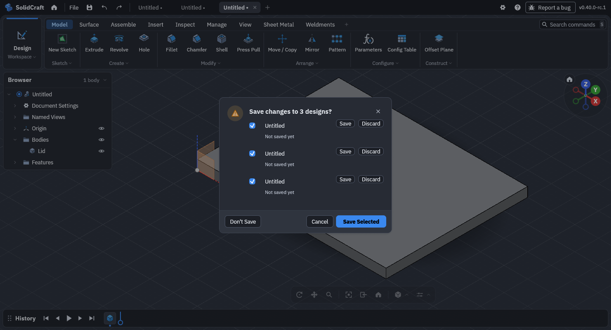

# No File Left Behind — specification

Version 0.1 (draft). The key words MUST, MUST NOT, SHOULD, SHOULD NOT and MAY are to be read
as described in [RFC 2119](https://www.rfc-editor.org/rfc/rfc2119).

## 1. When it applies

An application **closes several documents at once** when it quits, restarts to install an
update, closes a window with several tabs, or runs a command such as Close All. If two or more
of those documents have unsaved changes, it asks about them **once, in one list**: the
*list of unsaved work*, or *the list* for short.

- **1.1** With two or more unsaved documents in the set being closed, the application MUST show
  the list instead of one prompt per document.
- **1.2** With exactly one unsaved document, the application SHOULD keep its existing
  single-document prompt ("Save changes to *name*?"). One row in a list is no clearer than a
  question.
- **1.3** The list MUST hold only the documents the action would close. Quitting lists every
  open document; closing one window lists that window's documents only.
- **1.4** Documents with no unsaved changes MUST NOT appear in the list.

## 2. What the list shows

- **2.1 Title:** says the count, e.g. "Save changes to 3 documents?". It SHOULD use the
  application's own word for a document (design, drawing, image, project).
- **2.2 One row per unsaved document,** in the order the user sees them (tab order, window
  order). Each row has:
  - **a tick box,** ticked when the list opens (2.4);
  - **the document's name.** Clicking it SHOULD bring that document to the front, so the user
    can look before deciding;
  - **where it lives,** in muted text under the name: its file path, or **"Not saved yet"** for
    a document that has never been saved;
  - **its own Save and Discard buttons** (section 4).
- **2.3 The window's buttons:** **Save Selected** (the default, primary button), **Don't Save**
  and **Cancel**.
- **2.4** Every row MUST start ticked. The safe default is to keep work; unticking is a choice
  the user makes.
- **2.5** A long list MUST scroll inside the window. The buttons MUST stay visible, and the
  window MUST fit on the screen with any number of rows.

## 3. The window's buttons

- **3.1 Save Selected** saves the ticked documents, in row order.
  - It asks for a location (a save picker) **only** for ticked documents that have never been
    saved, one at a time. Documents with a file save to it without a question.
  - **3.1.1 No file left behind:** if any of those saves fails, or the user cancels a save
    picker, the application MUST NOT close **anything**. Not the documents already saved by
    this click, and not the unticked ones. The list stays open. The failed or cancelled row
    says why (3.4), and documents that did save show as saved.
  - **3.1.2** When every ticked document has saved, the application closes all the documents in
    the list (the unticked ones unsaved) and carries on with the action (quit, update, close).
- **3.2 Don't Save** closes every listed document without saving and carries on with the action.
  It SHOULD look less prominent than Save Selected, and MUST NOT be the default button.
- **3.3 Cancel** closes nothing and stops the action. The application stays as it was, with
  every document still open and still unsaved.
- **3.4** A failure MUST be shown on its row, in words the user can act on ("The disk is full",
  "You don't have permission to write to Documents"), not only as a code.

## 4. A row's own buttons

- **4.1** A row's **Save** saves that one document (asking for a location if it was never
  saved). When it succeeds, that document closes and its row leaves the list. If it fails or
  its picker is cancelled, the row stays, with the reason (3.4).
- **4.2** A row's **Discard** closes that one document without saving, and its row leaves the
  list.
- **4.3** When the last row has left the list, the application MUST carry on with the action,
  exactly as if the user had answered for all of them at once.
- **4.4** Answering one row MUST NOT change any other row's tick or state.

## 5. Keyboard, focus and screen readers

- **5.1** **Enter** activates Save Selected. **Escape** is Cancel. These match the
  single-document prompt, so muscle memory carries over.
- **5.2** Tab moves through the rows (tick box, name, Save, Discard) in order, then the window's
  buttons. Space toggles the focused tick box.
- **5.3** Each row MUST be one group for assistive technology, named after its document. The
  tick box's label names the document ("Save Report.docx"), and so do the row's Save and
  Discard ("Save Report.docx", "Discard Report.docx"), not just "Save" and "Discard".
- **5.4** The title's count MUST be announced when the window opens.

## 6. Edge cases

- **6.1 Read-only or moved file.** Saving where the file was is impossible, so the row's Save,
  and Save Selected, ask for a new location for that document, as for one never saved. The row
  says why ("The original file is read-only").
- **6.2 A save that takes time** (a large file, a network drive). The row shows that it is
  saving, and the window's buttons wait. Cancel stays available and MUST NOT leave a
  half-written file in place of the original. Write to a temporary file and replace the
  original only on success.
- **6.3 Two documents with the same name.** Their rows MUST be told apart by where they live
  (2.2). Never-saved documents with the same name are told apart by order ("Untitled",
  "Untitled 2").
- **6.4 The application is told to quit by the system** (logout, shutdown). It SHOULD show the
  list and ask the system for more time where the platform allows. If it can't wait, it MUST
  keep a recoverable copy of every unsaved document (autosave, crash recovery) rather than lose
  one.
- **6.5 A document changes while the list is open** (an autosave, a background edit). Its row
  stays, and saving saves its latest state.

## 7. Choosing the old behaviour

- **7.1** An application changing from one-prompt-per-document SHOULD offer a preference to
  keep the old prompts, such as "Ask about each unsaved document separately when closing
  several", off by default.

## 8. Scripts and automation

- **8.1** An application that can be driven by scripts or tests SHOULD let them read the list
  (rows, names, locations, ticks) and answer it: tick a set of rows and press one of the
  window's buttons, or answer one row. The answers MUST follow the same rules as clicks,
  including 3.1.1.

## Conformance

An application conforms to No File Left Behind when it meets every MUST in sections 1 to 6.
The [checklist](CHECKLIST.md) lists them for a review.
